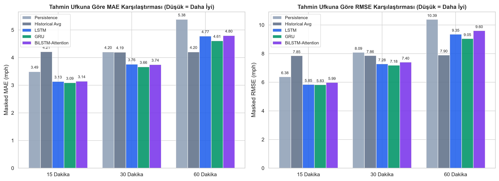
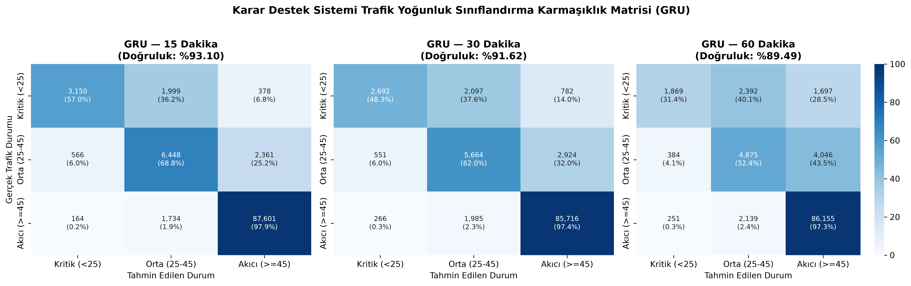
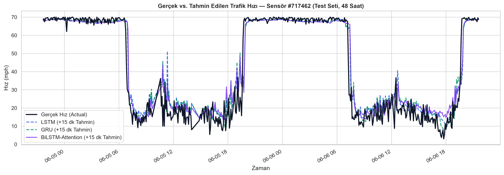
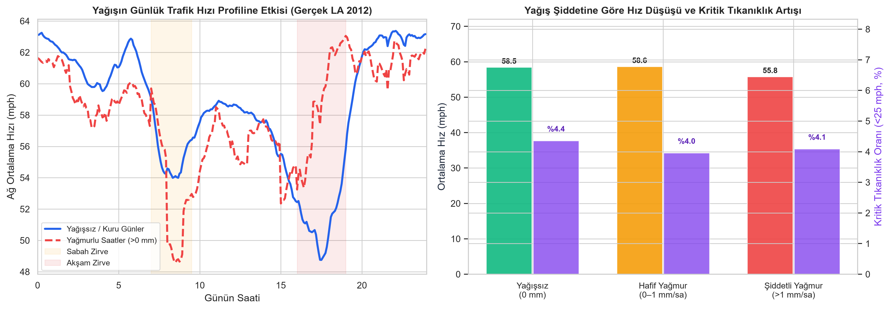

# Zaman Serisi Analizi ve Derin Öğrenme Yöntemleriyle Dinamik Trafik Akışı Tahmini

Gerçek **METR-LA** (Los Angeles 207 otoyol sensörü, 4 ay, 5 dakikalık aralıklar) veri seti ve **Open-Meteo 2012** tarihsel meteoroloji arşivi üzerinde çalışan, uçtan uca **Spatio-Temporal Derin Öğrenme + 3 Katmanlı (3-Tier) Karar Destek Sistemi**.

---

## Sistem Mimarisi (3-Tier Microservice Architecture)

```text
[METR-LA Gerçek Veri Seti (34.272 × 207) + Yol Ağı Mesafeleri + Open-Meteo 2012 LA]
        │
        ▼
[1. Model Katmanı — Python / PyTorch / FastAPI (:8000)]
   • Baselines      : Persistence, Historical Average (HA)
   • Deep Learning  : LSTM, GRU (En İyi Model), BiLSTM + Temporal Attention
   • Çoklu Ufuk     : +15 dk, +30 dk, +60 dk (Son 60 dk / 12 adım kayan pencere)
   • Özellikler     : Uzamsal Komşuluk (Gaussian Adjacency) + Döngüsel Zaman (sin/cos)
   • Canlı Çıkarım  : GET /api/ai/network-snapshot, /predict/{id}, POST /api/ai/predict/custom
        │  (Async HTTP / JSON)
        ▼
[2. Servis Katmanı — ASP.NET Core 9 Web API (:5100)]
   • Clean Architecture : TrafficFlow.Core / TrafficFlow.Infrastructure / TrafficFlow.API
   • Swagger UI         : http://localhost:5100/swagger
   • REST Endpoints     : /api/traffic/health, /sensors, /network-snapshot, /predict/{id},
                          POST /api/traffic/predict/custom, /experiments, /plots/{name}
        │  (REST / JSON)
        ▼
[3. Sunum Katmanı — ASP.NET Core 9 MVC + JavaScript (:5200)]
   • OpenStreetMap + Leaflet.js : 207 Gerçek LA Sensörü + Yol Ağı Komşuluk Çizgileri
   • Chart.js                   : Gerçek vs. Çoklu Model Tahmin Grafikleri
   • Karar Destek               : Kritik Tıkanıklık Uyarıları, Canlı Hava Durumu, Özel Tahmin Simülatörü
   • Akademik Panel             : Metrik Tabloları, Ablasyon, Dinamik 3×3 Confusion Matrix, 8×300 DPI Grafik
```

---

## Deneysel Sonuçlar (Gerçek METR-LA Test Seti — Son %20 Kronolojik)

### 1. Ana Model Karşılaştırması (Masked MAE / RMSE / MAPE / R²)

| Model | 15 dk MAE / RMSE / R² | 30 dk MAE / RMSE / R² | 60 dk MAE / RMSE / R² | Genel MAE | Genel RMSE | MAPE (%) |
|---|---|---|---|---:|---:|---:|
| **Persistence** (Baseline) | 3.49 / 6.38 / 0.776 | 4.20 / 8.09 / 0.645 | 5.38 / 10.39 / 0.434 | 4.357 | 8.287 | 11.18% |
| **Historical Avg** (Baseline) | 4.21 / 7.85 / 0.661 | 4.19 / 7.86 / 0.665 | 4.20 / 7.90 / 0.673 | 4.202 | 7.872 | 13.05% |
| **LSTM** (2 Katman, h=64) | 3.13 / 5.85 / 0.812 | 3.76 / 7.28 / 0.713 | 4.77 / 9.35 / 0.541 | 3.889 | 7.494 | 11.44% |
| **BiLSTM-Attention** | 3.14 / 5.99 / 0.803 | 3.74 / 7.40 / 0.703 | 4.80 / 9.60 / 0.516 | 3.895 | 7.664 | 11.65% |
| **GRU (En İyi Model ★)** | **3.09 / 5.83 / 0.813** | **3.66 / 7.18 / 0.720** | **4.61 / 9.05 / 0.571** | **3.785** | **7.354** | **11.14%** |

### 2. Hiperparametre & Uzamsal Komşuluk Ablasyonu

| Deney Konfigürasyonu | Katman | Hidden | Uzamsal Komşuluk | Parametre | Genel MAE | Genel RMSE | R² |
|---|---:|---:|---|---:|---:|---:|---:|
| LSTM (1 Katman, h=32) | 1 | 32 | Evet | 5.763 | 3.933 | 7.531 | 0.6853 |
| LSTM (2 Katman, h=64, **Uzamsal Yok**) | 2 | 64 | **Hayır** | 53.763 | 4.006 | 7.614 | 0.6783 |
| LSTM (2 Katman, h=64, **Uzamsal Var**) | 2 | 64 | **Evet** | 54.019 | **3.889** | **7.494** | **0.6886** |
| LSTM (3 Katman, h=96, Uzamsal Var) | 3 | 96 | Evet | 193.923 | **3.796** | **7.344** | **0.7020** |

### 3. Karar Destek Tıkanıklık Sınıflandırması (Confusion Matrix — GRU)
Hız tahminleri operasyonel sınıflara (*Kritik `<25 mph`*, *Orta `25–45 mph`*, *Akıcı `≥45 mph`*) dönüştürüldüğünde:
- **+15 Dakika:** Doğruluk **`%93.10`** | Weighted F1 **`0.9298`** | Kritik Precision **`0.8119`**
- **+30 Dakika:** Doğruluk **`%91.62`** | Weighted F1 **`0.9135`** | Kritik Precision **`0.7672`**
- **+60 Dakika:** Doğruluk **`%89.49`** | Weighted F1 **`0.8866`** | Kritik Precision **`0.7464`**

### 4. Dışsal Meteorolojik Etki Analizi (Open-Meteo 2012 LA Arşivi)
- **Yağışsız (`0 mm`, 33.000 adım):** Ortalama Hız **`58.46 mph`**
- **Orta/Şiddetli Yağmur (`>1 mm/sa`, 348 adım):** Ortalama Hız **`55.81 mph`** (*−2.65 mph / −%4.5 düşüş*)

---

## Üretilen Tüm Tez Grafikleri (8 Adet, 300 DPI — `AI_Models/plots/`)

1. `01_eda_daily_weekly_pattern.png` — METR-LA Hafta İçi / Hafta Sonu Zirve Saatler ve Hız Dağılımı
2. `02_training_validation_curves.png` — LSTM / GRU / BiLSTM-Attention Eğitim ve Doğrulama Eğrileri
3. `03_model_comparison_horizons.png` — 15 / 30 / 60 dk Ufuklarına Göre MAE ve RMSE Karşılaştırması
4. `04_ablation_hyperparameters.png` — Hiperparametre ve Uzamsal Komşuluk Ablasyonu
5. `05_actual_vs_predicted_timeseries.png` — 48 Saatlik Gerçek vs. Tahmin Zaman Serisi
6. `06_error_distribution_scatter.png` — Gerçek-Tahmin Korelasyonu (R²) ve Hata (Residual) Dağılımı
7. `07_congestion_confusion_matrix.png` — 3×3 Tıkanıklık Sınıflandırma Karmaşıklık Matrisi (Confusion Matrix)
8. `08_weather_traffic_impact.png` — Gerçek LA 2012 Yağış Verisinin Trafik Hızına Etkisi






*(Ham CSV/JSON deney tabloları `AI_Models/results/` klasöründedir.)*

---

## Kurulum ve Çalıştırma

### 1. Ham Veri Seti (`metr-la.h5`)
54.4 MB boyutundaki `metr-la.h5` dosyası `.gitignore` ile hariç tutulmuştur. Klonladıktan sonra `AI_Models/data/metr-la.h5` konumuna indirin:
```bash
curl -L -o AI_Models/data/metr-la.h5 https://huggingface.co/datasets/jimmygao3218/METRLA/resolve/main/metr-la.h5
```

### 2. Python Sanal Ortamı
```powershell
python -m venv AI_Models\venv
.\AI_Models\venv\Scripts\pip.exe install -r AI_Models\requirements.txt
```

### 3. Tüm Sistemi Tek Hareketle Başlatma (3 Servis)
- **VS Code ile:** `Ctrl + Shift + B` (*`Tum Sistemi Baslat (AI + API + MVC)`*)
- **Windows Batch ile:** `.\start_all.bat`

Ardından:
- **Karar Destek Dashboard:** http://localhost:5200
- **Swagger UI (REST API):** http://localhost:5100/swagger
- **AI Mikroservisi Sağlık:** http://127.0.0.1:8000/health

### 4. Deneyleri Yeniden Çalıştırma
```powershell
.\AI_Models\venv\Scripts\python.exe .\AI_Models\src\train_experiments.py
.\AI_Models\venv\Scripts\python.exe .\AI_Models\src\evaluate_confusion_matrix.py
.\AI_Models\venv\Scripts\python.exe .\AI_Models\src\weather_analysis.py
```

---

## Kaynakça
1. Lv, Y., Duan, Y., Kang, W., Li, Z., & Wang, F. Y. (2015). *Traffic flow prediction with big data: a deep learning approach.* IEEE Transactions on Intelligent Transportation Systems, 16(2), 865-873.
2. Ma, X., Tao, Z., Wang, Y., Yu, H., & Wang, Y. (2015). *Long short-term memory neural network for traffic speed prediction using remote microwave sensor data.* Transportation Research Part C: Emerging Technologies, 54, 187-197.
3. Yu, B., Yin, H., & Zhu, Z. (2018). *Spatio-temporal graph convolutional networks: A deep learning framework for traffic forecasting.* IJCAI.
4. Li, Y., Yu, R., Shahabi, C., & Liu, Y. (2018). *Diffusion Convolutional Recurrent Neural Network: Data-Driven Traffic Forecasting.* ICLR (METR-LA Benchmark).
